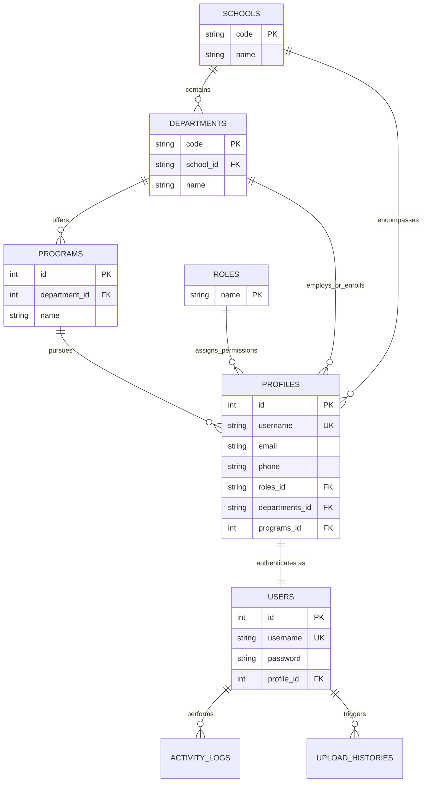
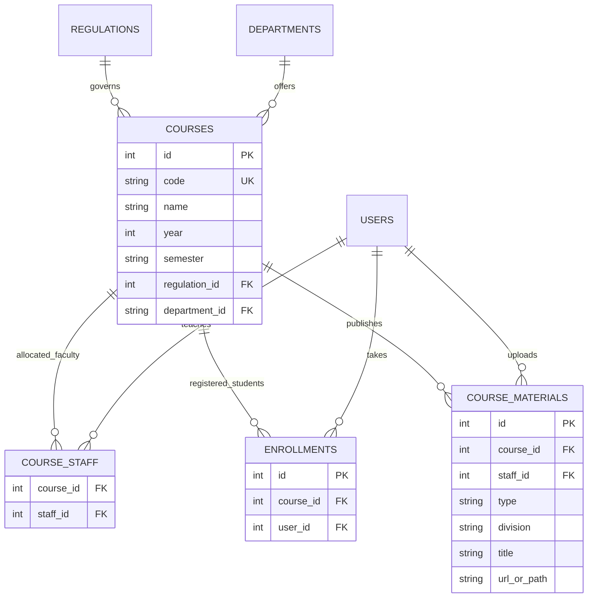
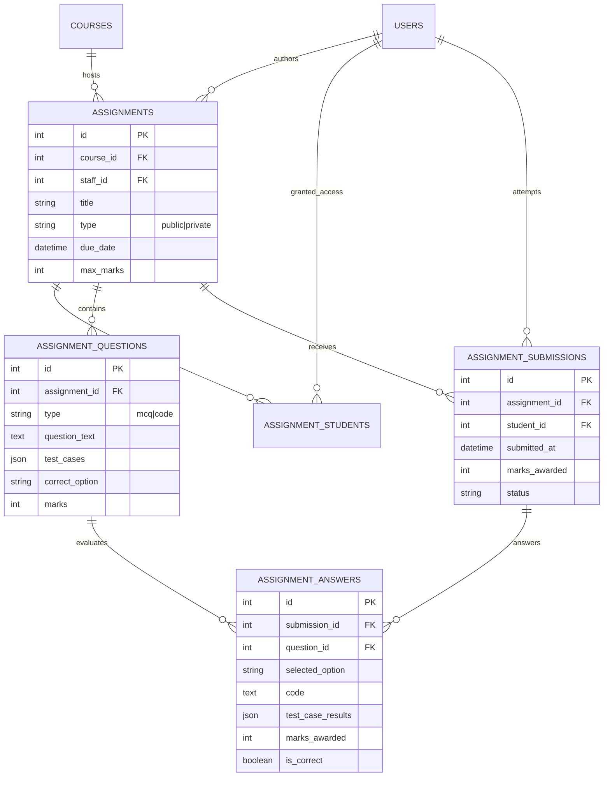
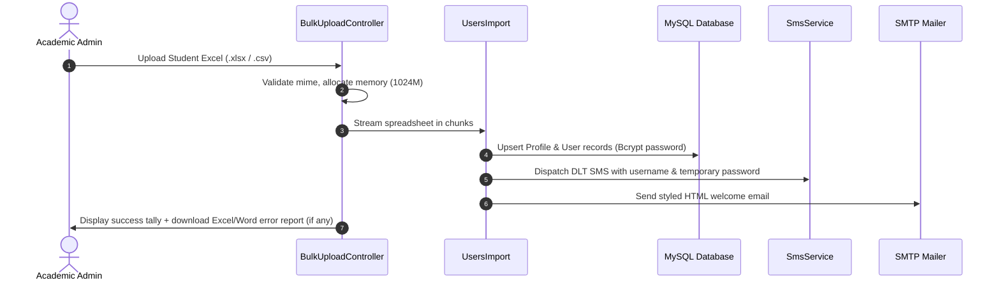
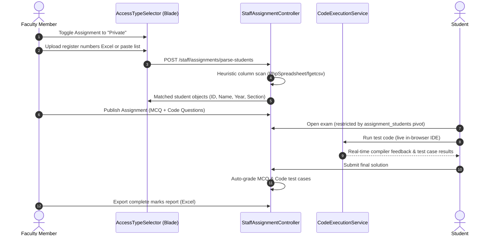
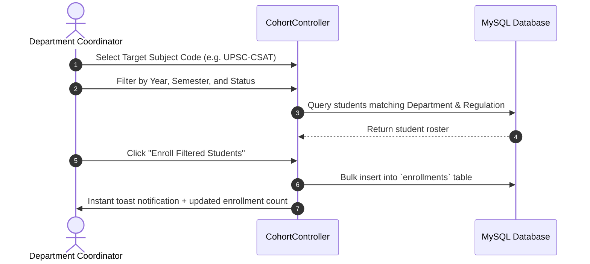

# Learning Management System (LMS) — Deep Technical Architecture & Specification Manual

---

## Table of Contents
1. [Executive Summary & System Architecture](#1-executive-summary--system-architecture)
2. [Database Dictionary & Table Specifications](#2-database-dictionary--table-specifications)
3. [Entity-Relationship (ER) Diagrams](#3-entity-relationship-er-diagrams)
4. [Complete Route Manifest & API Directory](#4-complete-route-manifest--api-directory)
5. [Roles, Permissions & Security Matrix](#5-roles-permissions--security-matrix)
6. [Core Services & Backend Engines](#6-core-services--backend-engines)
7. [End-to-End System Workflows](#7-end-to-end-system-workflows)
8. [Frontend & UI Component Architecture](#8-frontend--ui-component-architecture)

---

## 1. Executive Summary & System Architecture

The **Vignan Learning Management System (LMS)** is an enterprise academic administration and digital examination platform developed with **Laravel 10**, **PHP 8.5**, and **MySQL**. It unifies collegiate governance, course delivery, online coding evaluations, and multi-department student lifecycles into a single performant application.

### 1.1 Architectural Topology
```
┌─────────────────────────────────────────────────────────────────────────────┐
│                           CLIENT / BROWSER LAYER                            │
│           (Blade Views + Tailwind CSS + Alpine.js + Live Fetch API)         │
└──────────────────────────────────────┬──────────────────────────────────────┘
                                       │ HTTP / HTTPS (SSL)
                                       ▼
┌─────────────────────────────────────────────────────────────────────────────┐
│                     MIDDLEWARE & SECURITY PIPELINE                          │
│     [EncryptCookies] ➔ [VerifyCsrfToken] ➔ [Authenticate] ➔ [RoleMiddleware] │
└──────────────────────────────────────┬──────────────────────────────────────┘
                                       │ Authorized Request
                                       ▼
┌─────────────────────────────────────────────────────────────────────────────┐
│                       CONTROLLER & ROUTING LAYER                            │
│  • LoginController      • AcademicController       • StaffAssignmentCtrl    │
│  • BulkUploadController • StudentAssignmentCtrl    • SshAdminController     │
│  • CohortController     • CourseMaterialController • CivilAdminController   │
└──────────────┬───────────────────────┬───────────────────────┬──────────────┘
               │                       │                       │
               ▼                       ▼                       ▼
┌─────────────────────────┐ ┌───────────────────────┐ ┌───────────────────────┐
│     SERVICE LAYER       │ │     MODEL / ORM       │ │   EXTERNAL GATEWAYS   │
│ • CodeExecutionService  │ │ • User     • Course   │ │ • DLT SMS API (HTTP)  │
│ • CacheService          │ │ • Profile  • Assignmt │ │ • SMTP Mail Server    │
│ • ActivityLogger        │ │ • Material • Question │ │ • Discord Webhooks    │
│ • SmsService            │ │ • Role     • Program  │ │ • Wandbox Online API  │
└─────────────────────────┘ └───────────────────────┘ └───────────────────────┘
                                       │
                                       ▼
┌─────────────────────────────────────────────────────────────────────────────┐
│                         PERSISTENCE & CACHE                                 │
│          MySQL 8.0 InnoDB (Relational) + File / Redis Cache (Key-Value)      │
└─────────────────────────────────────────────────────────────────────────────┘
```

### 1.2 Technology Stack
- **Backend Framework**: Laravel 10.x running on PHP 8.5 (NTS x64)
- **Database Engine**: MySQL 8.0 (InnoDB engine with full foreign key constraints and transactional integrity)
- **Frontend Stack**: Laravel Blade templating, Tailwind CSS 3.x, Alpine.js, Vanilla JavaScript, Chart.js / ApexCharts
- **Document & Spreadsheet Processors**: `maatwebsite/excel` (v3.1), `phpoffice/phpspreadsheet` (v1.29)
- **Communication Gateways**: Carrier DLT HTTP SMS API, SMTP / SwiftMailer
- **Code Execution Engines**: Local CLI execution sandbox (GCC, G++, Python, Javac) with Wandbox fallback

---

## 2. Database Dictionary & Table Specifications

The LMS database utilizes strict referential integrity. Below is the detailed schema dictionary for all primary tables:

### 2.1 `schools`
Organizes university faculties into broad administrative colleges.
| Column | Type | Nullable | Default | Description |
| :--- | :--- | :--- | :--- | :--- |
| `id` | `BIGINT UNSIGNED` | NO | Auto Inc | Primary Key |
| `code` | `VARCHAR(255)` | NO | None | Unique school identifier code (e.g. `SOE`, `SSH`) |
| `name` | `VARCHAR(255)` | NO | None | Full academic name (e.g. `School of Engineering`) |
| `created_at` / `updated_at` | `TIMESTAMP` | YES | NULL | Standard audit timestamps |

### 2.2 `departments`
Academic departments governed within specific schools.
| Column | Type | Nullable | Default | Description |
| :--- | :--- | :--- | :--- | :--- |
| `id` | `BIGINT UNSIGNED` | NO | Auto Inc | Primary Key |
| `code` | `VARCHAR(255)` | NO | None | Unique departmental code (e.g. `CSE`, `ECE`, `MECH`) |
| `school_id` | `VARCHAR(255)` | NO | None | Foreign Key referencing `schools(code)` (ON DELETE CASCADE) |
| `name` | `VARCHAR(255)` | NO | None | Department name |
| `created_at` / `updated_at` | `TIMESTAMP` | YES | NULL | Standard audit timestamps |

### 2.3 `programs`
Specific degree programs offered by departments.
| Column | Type | Nullable | Default | Description |
| :--- | :--- | :--- | :--- | :--- |
| `id` | `BIGINT UNSIGNED` | NO | Auto Inc | Primary Key |
| `department_id` | `BIGINT UNSIGNED` | NO | None | Foreign Key referencing `departments(id)` |
| `name` | `VARCHAR(255)` | NO | None | Degree title (e.g. `B.Tech Computer Science & Engineering`) |
| `code` | `VARCHAR(255)` | YES | NULL | Program short identifier |
| `created_at` / `updated_at` | `TIMESTAMP` | YES | NULL | Standard audit timestamps |

### 2.4 `roles`
System-wide access roles.
| Column | Type | Nullable | Default | Description |
| :--- | :--- | :--- | :--- | :--- |
| `id` | `BIGINT UNSIGNED` | NO | Auto Inc | Primary Key |
| `name` | `VARCHAR(255)` | NO | None | Unique role key (`sa`, `admin`, `sta`, `stu`, `civil_admin`, `ssh_admin`) |
| `created_at` / `updated_at` | `TIMESTAMP` | YES | NULL | Timestamps |
| `deleted_at` | `TIMESTAMP` | YES | NULL | Soft delete support |

### 2.5 `profiles`
Central entity containing demographic and academic attributes for all system actors.
| Column | Type | Nullable | Default | Description |
| :--- | :--- | :--- | :--- | :--- |
| `id` | `BIGINT UNSIGNED` | NO | Auto Inc | Primary Key |
| `username` | `VARCHAR(255)` | NO | None | Unique roll number or staff ID |
| `first_name` | `VARCHAR(255)` | NO | None | First name |
| `middle_name`| `VARCHAR(255)` | YES | NULL | Optional middle name |
| `last_name` | `VARCHAR(255)` | NO | None | Last name / Surname |
| `email` | `VARCHAR(255)` | YES | NULL | Email address (non-unique to permit shared emails) |
| `phone` | `VARCHAR(255)` | YES | NULL | Mobile contact number (used for DLT SMS) |
| `roles_id` | `VARCHAR(255)` | YES | NULL | Foreign Key referencing `roles(name)` |
| `schools_id`| `VARCHAR(255)` | YES | NULL | Foreign Key referencing `schools(code)` |
| `departments_id`| `VARCHAR(255)`| YES | NULL | Foreign Key referencing `departments(code)` |
| `programs_id`| `BIGINT UNSIGNED`| YES | NULL | Foreign Key referencing `programs(id)` |
| `designation`| `VARCHAR(255)`| YES | NULL | Designation (e.g. `Assistant Professor`, `Student`) |
| `academic_year`| `VARCHAR(255)`| YES | NULL | Academic year (1, 2, 3, 4) |
| `semester` | `VARCHAR(255)` | YES | NULL | Active semester (1 through 8) |
| `section` | `VARCHAR(255)` | YES | NULL | Section identifier (e.g. `A`, `B`, `C`) |
| `photo` | `VARCHAR(255)` | YES | NULL | File path to avatar image |
| `created_at` / `updated_at` | `TIMESTAMP` | YES | NULL | Timestamps |
| `deleted_at` | `TIMESTAMP` | YES | NULL | Soft delete support |

### 2.6 `users`
Authentication credentials tied 1-to-1 with a `profile`.
| Column | Type | Nullable | Default | Description |
| :--- | :--- | :--- | :--- | :--- |
| `id` | `BIGINT UNSIGNED` | NO | Auto Inc | Primary Key |
| `username` | `VARCHAR(255)` | NO | None | Unique login identifier |
| `profile_id` | `BIGINT UNSIGNED` | NO | None | Foreign Key referencing `profiles(id)` (ON DELETE CASCADE) |
| `password` | `VARCHAR(255)` | NO | None | Bcrypt hashed secret |
| `failed_login_attempts` | `INT` | NO | 0 | Failed password attempts counter |
| `requires_password_reset`| `TINYINT(1)` | NO | 0 | Flags forced password change |
| `remember_token` | `VARCHAR(100)` | YES | NULL | "Remember me" session token |
| `created_at` / `updated_at` | `TIMESTAMP` | YES | NULL | Standard audit timestamps |

### 2.7 `regulations`
Curricular regulations (e.g. `R22`, `R19`).
| Column | Type | Nullable | Default | Description |
| :--- | :--- | :--- | :--- | :--- |
| `id` | `BIGINT UNSIGNED` | NO | Auto Inc | Primary Key |
| `name` | `VARCHAR(255)` | NO | None | Regulation title (e.g. `R22 Regulation`) |
| `year` | `INT` | NO | None | Starting year |
| `program_type` | `VARCHAR(255)` | YES | NULL | Target program level |
| `curriculum` | `VARCHAR(255)` | YES | NULL | Curriculum classification |
| `created_at` / `updated_at` | `TIMESTAMP` | YES | NULL | Timestamps |

### 2.8 `courses`
Subjects delivered across academic programs.
| Column | Type | Nullable | Default | Description |
| :--- | :--- | :--- | :--- | :--- |
| `id` | `BIGINT UNSIGNED` | NO | Auto Inc | Primary Key |
| `regulation_id` | `BIGINT UNSIGNED`| YES | NULL | Foreign Key referencing `regulations(id)` |
| `department_id` | `VARCHAR(255)` | NO | None | Department code referencing `departments(code)` |
| `code` | `VARCHAR(255)` | NO | None | Unique course code (e.g. `CS301`, `UPSC-CSAT`) |
| `name` | `VARCHAR(255)` | NO | None | Subject title |
| `year` | `INT` | YES | NULL | Curriculum year level |
| `semester` | `VARCHAR(255)` | YES | NULL | Semester level |
| `created_at` / `updated_at` | `TIMESTAMP` | YES | NULL | Timestamps |

### 2.9 `course_staff` (Pivot)
Allocates faculty members to courses.
| Column | Type | Description |
| :--- | :--- | :--- |
| `course_id` | `BIGINT UNSIGNED` | Foreign Key referencing `courses(id)` (ON DELETE CASCADE) |
| `staff_id` | `BIGINT UNSIGNED` | Foreign Key referencing `users(id)` (ON DELETE CASCADE) |

### 2.10 `enrollments` (Pivot)
Tracks student subject registrations.
| Column | Type | Description |
| :--- | :--- | :--- |
| `id` | `BIGINT UNSIGNED` | Primary Key |
| `course_id` | `BIGINT UNSIGNED` | Foreign Key referencing `courses(id)` (ON DELETE CASCADE) |
| `user_id` | `BIGINT UNSIGNED` | Foreign Key referencing `users(id)` (ON DELETE CASCADE) |
| `created_at` / `updated_at` | `TIMESTAMP` | Registration timestamps |

### 2.11 `course_materials`
Learning assets and digital documents categorized into 11 academic divisions.
| Column | Type | Nullable | Default | Description |
| :--- | :--- | :--- | :--- | :--- |
| `id` | `BIGINT UNSIGNED` | NO | Auto Inc | Primary Key |
| `course_id` | `BIGINT UNSIGNED` | NO | None | Foreign Key referencing `courses(id)` |
| `staff_id` | `BIGINT UNSIGNED` | NO | None | Foreign Key referencing `users(id)` (uploader) |
| `type` | `VARCHAR(255)` | NO | None | `file` or `link` |
| `division` | `VARCHAR(255)` | YES | NULL | Academic division category |
| `platform` | `VARCHAR(255)` | YES | NULL | Link provider (YouTube, Drive, etc.) |
| `title` | `VARCHAR(255)` | NO | None | Human readable material name |
| `url_or_path`| `VARCHAR(255)` | NO | None | Local storage disk path or external HTTP URL |
| `created_at` / `updated_at` | `TIMESTAMP` | YES | NULL | Timestamps |

### 2.12 `assignments`
Online examinations and evaluations.
| Column | Type | Nullable | Default | Description |
| :--- | :--- | :--- | :--- | :--- |
| `id` | `BIGINT UNSIGNED` | NO | Auto Inc | Primary Key |
| `course_id` | `BIGINT UNSIGNED` | NO | None | Foreign Key referencing `courses(id)` |
| `staff_id` | `BIGINT UNSIGNED` | NO | None | Foreign Key referencing `users(id)` |
| `title` | `VARCHAR(255)` | NO | None | Test title |
| `description`| `TEXT` | YES | NULL | Instructions and guidelines |
| `max_marks` | `INT` | NO | 100 | Maximum attainable score |
| `due_date` | `DATETIME` | NO | None | Submission deadline cutoff |
| `attachment_path`| `VARCHAR(255)`| YES| NULL | Supplementary reference file |
| `status` | `ENUM` | NO | `published` | `published`, `draft`, `closed` |
| `type` | `VARCHAR(20)` | NO | `public` | `public` (enrolled cohort) or `private` (whitelist) |
| `created_at` / `updated_at` | `TIMESTAMP` | YES | NULL | Timestamps |

### 2.13 `assignment_students` (Pivot)
Explicit whitelist of students granted access to Private assignments.
| Column | Type | Description |
| :--- | :--- | :--- |
| `id` | `BIGINT UNSIGNED` | Primary Key |
| `assignment_id` | `BIGINT UNSIGNED` | Foreign Key referencing `assignments(id)` (ON DELETE CASCADE) |
| `student_id` | `BIGINT UNSIGNED` | Foreign Key referencing `users(id)` (ON DELETE CASCADE) |
| `created_at` / `updated_at` | `TIMESTAMP` | Grant timestamps |

### 2.14 `assignment_questions`
Questions attached to assignments (supports MCQ and dynamic code evaluation).
| Column | Type | Nullable | Default | Description |
| :--- | :--- | :--- | :--- | :--- |
| `id` | `BIGINT UNSIGNED` | NO | Auto Inc | Primary Key |
| `assignment_id` | `BIGINT UNSIGNED` | NO | None | Foreign Key referencing `assignments(id)` |
| `type` | `VARCHAR(20)` | NO | `mcq` | `mcq` or `code` |
| `question_text` | `LONGTEXT` | NO | None | Question prompt (supports Markdown/KaTeX) |
| `image` | `VARCHAR(255)` | YES | NULL | Uploaded diagram or figure |
| `allowed_languages`| `VARCHAR(255)`| YES | NULL | Permitted languages (e.g. `c,python,java`) |
| `starter_code` | `LONGTEXT` | YES | NULL | JSON map of starter code per language |
| `test_cases` | `LONGTEXT` | YES | NULL | JSON array of `[input, expected_output, is_hidden]` |
| `option_a` | `TEXT` | YES | NULL | Option A (for MCQ) |
| `option_b` | `TEXT` | YES | NULL | Option B (for MCQ) |
| `option_c` | `TEXT` | YES | NULL | Option C (for MCQ) |
| `option_d` | `TEXT` | YES | NULL | Option D (for MCQ) |
| `correct_option` | `ENUM('A','B','C','D')`| YES| NULL | Answer key (for MCQ) |
| `marks` | `INT` | NO | 1 | Question score weight |
| `explanation` | `TEXT` | YES | NULL | Solution remarks |
| `order` | `INT` | NO | 0 | Display sequence order |
| `created_at` / `updated_at` | `TIMESTAMP` | YES | NULL | Timestamps |

### 2.15 `assignment_submissions`
Student examination attempt headers.
| Column | Type | Nullable | Default | Description |
| :--- | :--- | :--- | :--- | :--- |
| `id` | `BIGINT UNSIGNED` | NO | Auto Inc | Primary Key |
| `assignment_id` | `BIGINT UNSIGNED` | NO | None | Foreign Key referencing `assignments(id)` |
| `student_id` | `BIGINT UNSIGNED` | NO | None | Foreign Key referencing `users(id)` |
| `submission_text`| `LONGTEXT` | YES | NULL | Optional text response |
| `file_path` | `VARCHAR(255)` | YES | NULL | Uploaded solution bundle |
| `submitted_at` | `DATETIME` | YES | NULL | Exact submission timestamp |
| `status` | `VARCHAR(255)` | NO | `submitted`| `submitted`, `graded`, `late` |
| `marks_awarded` | `INT` | YES | NULL | Total scored marks |
| `feedback` | `TEXT` | YES | NULL | Evaluator feedback |
| `graded_at` | `DATETIME` | YES | NULL | Evaluation completion time |
| `created_at` / `updated_at` | `TIMESTAMP` | YES | NULL | Timestamps |

### 2.16 `assignment_answers`
Individual question responses within a submission.
| Column | Type | Nullable | Default | Description |
| :--- | :--- | :--- | :--- | :--- |
| `id` | `BIGINT UNSIGNED` | NO | Auto Inc | Primary Key |
| `submission_id` | `BIGINT UNSIGNED` | NO | None | Foreign Key referencing `assignment_submissions(id)` |
| `question_id` | `BIGINT UNSIGNED` | NO | None | Foreign Key referencing `assignment_questions(id)` |
| `selected_option`| `ENUM('A','B','C','D')`| YES| NULL | Student's chosen MCQ choice |
| `code` | `LONGTEXT` | YES | NULL | Submitted source code (for coding questions) |
| `language` | `VARCHAR(50)` | YES | NULL | Submitted code language (`c`, `java`, `python`) |
| `test_case_results`| `LONGTEXT` | YES | NULL | JSON results of executed test cases |
| `code_output` | `LONGTEXT` | YES | NULL | Sandbox execution logs / compiler messages |
| `marks_awarded` | `INT` | NO | 0 | Score earned for this question |
| `is_correct` | `TINYINT(1)` | NO | 0 | Automated validation status |
| `created_at` / `updated_at` | `TIMESTAMP` | YES | NULL | Timestamps |

### 2.17 `activity_logs`
Immutable audit records for compliance and forensic analysis.
| Column | Type | Nullable | Default | Description |
| :--- | :--- | :--- | :--- | :--- |
| `id` | `BIGINT UNSIGNED` | NO | Auto Inc | Primary Key |
| `user_id` | `BIGINT UNSIGNED` | YES | NULL | Actor ID referencing `users(id)` |
| `user_role` | `VARCHAR(255)` | YES | NULL | Role held during event |
| `department_id` | `VARCHAR(255)` | YES | NULL | Department context |
| `school_id` | `VARCHAR(255)` | YES | NULL | School context |
| `module` | `VARCHAR(255)` | NO | None | Functional category (e.g. `Academics`, `Auth`) |
| `action` | `VARCHAR(255)` | NO | None | Machine key (`course_created`, `user_reset`) |
| `action_title` | `VARCHAR(255)` | NO | None | Readable title |
| `severity` | `VARCHAR(255)` | NO | `info` | `info`, `success`, `warning`, `danger` |
| `description` | `TEXT` | NO | None | Contextual audit log details |
| `ip_address` | `VARCHAR(45)` | YES | NULL | Client IPv4 / IPv6 address |
| `user_agent` | `TEXT` | YES | NULL | Browser agent |
| `created_at` / `updated_at` | `TIMESTAMP` | YES | NULL | Log generation timestamp |

### 2.18 `upload_histories`
Status records for asynchronous bulk file uploads.
| Column | Type | Nullable | Default | Description |
| :--- | :--- | :--- | :--- | :--- |
| `id` | `BIGINT UNSIGNED` | NO | Auto Inc | Primary Key |
| `file_name` | `VARCHAR(255)` | NO | None | Original spreadsheet name |
| `target_role` | `VARCHAR(50)` | NO | None | Target import role (`stu`, `sta`, `admin`) |
| `status` | `VARCHAR(50)` | NO | `processing`| `processing`, `completed`, `failed` |
| `total_rows` | `INT` | NO | 0 | Total rows identified |
| `processed_rows`| `INT` | NO | 0 | Successfully parsed rows |
| `error_message` | `LONGTEXT` | YES | NULL | JSON error details or failure dump |
| `uploaded_by` | `BIGINT UNSIGNED` | NO | None | Foreign Key referencing `users(id)` |
| `created_at` / `updated_at` | `TIMESTAMP` | YES | NULL | Timestamps |

### 2.19 `user_sessions`
Tracks active user session duration, login timestamps, last activity timestamps, logout timestamps, action volumes, and client metadata for real-time and historical analytics.

| Column | Type | Nullable | Default | Description / Notes |
| :--- | :--- | :--- | :--- | :--- |
| `id` | `BIGINT UNSIGNED` | NO | Auto Inc | Primary Key |
| `session_id` | `VARCHAR(191)` | YES | NULL | Active session token (indexed) |
| `user_id` | `BIGINT UNSIGNED` | YES | NULL | Foreign Key referencing `users(id)` |
| `department_id` | `VARCHAR(255)` | YES | NULL | Department code (e.g. `dep_it`) |
| `school_id` | `VARCHAR(255)` | YES | NULL | School code |
| `user_name` | `VARCHAR(255)` | YES | NULL | Display name of user |
| `user_role` | `VARCHAR(255)` | YES | NULL | Role (`sa`, `admin`, `sta`, `stu`, etc.) |
| `ip_address` | `VARCHAR(45)` | YES | NULL | Client IP address |
| `user_agent` | `TEXT` | YES | NULL | Browser / device client string |
| `login_at` | `TIMESTAMP` | YES | NULL | Session start timestamp |
| `last_activity_at` | `TIMESTAMP` | YES | NULL | Most recent activity / heartbeat timestamp |
| `logout_at` | `TIMESTAMP` | YES | NULL | Explicit logout timestamp |
| `duration_seconds` | `BIGINT UNSIGNED` | NO | 0 | Total duration in seconds spent in session |
| `actions_count` | `INT UNSIGNED` | NO | 1 | Request / operation count in session |
| `status` | `ENUM('active','logged_out','timed_out')` | NO | `'active'` | Session lifecycle state |
| `created_at` / `updated_at` | `TIMESTAMP` | YES | NULL | Standard Eloquent timestamps |

---

## 3. Entity-Relationship (ER) Diagrams

### 3.1 Organization, Profiles & Security Architecture


### 3.2 Curriculum, Courses & Delivery Architecture


### 3.3 Assessment, Question Bank & Automated IDE Sandbox


---

## 4. Complete Route Manifest & API Directory

| Method | Route Path | Name | Controller Action | Middleware |
| :--- | :--- | :--- | :--- | :--- |
| **`GET`** | `/` | `login` | `LoginController@showLogin` | `web`, `guest` |
| **`POST`** | `/authenticate` | `authenticate` | `LoginController@login` | `web` |
| **`POST`** | `/forgot-password` | `password.forgot` | `LoginController@forgotPassword` | `web` |
| **`POST`** / **`GET`** | `/logout` | `logout` | `LoginController@logout` | `web` |
| **`GET`** | `/dashboard` | `dashboard` | `DashboardController@index` | `web`, `auth` |
| **`GET`** / **`PUT`** | `/profile` | `profile.edit` / `profile.update` | `DashboardController@editProfile` / `@updateProfile` | `web`, `auth` |
| **`GET`** / **`PUT`** | `/password` | `password.edit` / `password.update` | `DashboardController@editPassword` / `@updatePassword` | `web`, `auth` |
| **`RESOURCE`** | `/coordinators` | `coordinators.*` | `CoordinatorController` | `web`, `auth`, `role:sa,ssh_admin` |
| **`GET`** | `/activity-logs` | `activity_logs.index` | `ActivityLogController@index` | `web`, `auth`, `role:sa,ssh_admin` |
| **`GET`** | `/activity-logs/export`| `activity_logs.export` | `ActivityLogController@export` | `web`, `auth`, `role:sa,ssh_admin` |
| **`GET`** | `/academic/departments-schools` | `academic.departments.index` | `SchoolDepartmentController@index` | `web`, `auth`, `role:sa,ssh_admin` |
| **`POST`** / **`PUT`** / **`DELETE`** | `/academic/schools/*` | `academic.schools.*` | `SchoolDepartmentController` | `web`, `auth`, `role:sa,ssh_admin` |
| **`POST`** / **`PUT`** / **`DELETE`** | `/academic/departments/*` | `academic.departments.*` | `SchoolDepartmentController` | `web`, `auth`, `role:sa,ssh_admin` |
| **`GET`** | `/enrollment-insights`| `academic.enrollment_insights` | `AcademicController@enrollmentInsights` | `web`, `auth`, `role:sa,ssh_admin` |
| **`RESOURCE`** | `/civil-services/courses` | `civil.courses.*` | `CivilCourseController` | `web`, `auth`, `role:sa,civil_admin` |
| **`GET`** / **`POST`** | `/civil-services/students` | `civil.students.*` | `CivilAdminController` | `web`, `auth`, `role:sa,civil_admin` |
| **`GET`** | `/ssh/dashboard` | `ssh.dashboard` | `SshAdminController@index` | `web`, `auth`, `role:sa,ssh_admin` |
| **`RESOURCE`** | `/ssh/students` | `ssh.students.*` | `SshAdminController` | `web`, `auth`, `role:sa,ssh_admin` |
| **`RESOURCE`** | `/ssh/courses` | `ssh.courses.*` | `SshAdminController` | `web`, `auth`, `role:sa,ssh_admin` |
| **`RESOURCE`** | `/students` | `students.*` | `StudentController` | `web`, `auth`, `role:sa,admin,ssh_admin,civil_admin` |
| **`RESOURCE`** | `/staff` | `staff.*` | `StaffController` | `web`, `auth`, `role:sa,admin,ssh_admin,civil_admin` |
| **`POST`** | `/bulk-upload` | `bulk-upload.store` | `BulkUploadController@store` | `web`, `auth`, `role:sa,admin,ssh_admin,civil_admin` |
| **`GET`** | `/regulations` | `academic.regulations` | `AcademicController@regulations` | `web`, `auth`, `role:sa,admin,ssh_admin,civil_admin` |
| **`GET`** | `/courses` | `academic.courses` | `AcademicController@courses` | `web`, `auth`, `role:sa,admin,ssh_admin,civil_admin` |
| **`GET`** / **`POST`** | `/cohort-enrollment` | `academic.cohorts.*` | `CohortController` | `web`, `auth`, `role:sa,admin,ssh_admin,civil_admin` |
| **`GET`** | `/staff/courses` | `staff.courses.index` | `CourseMaterialController@myCourses` | `web`, `auth`, `role:sta,admin,sa` |
| **`GET`** / **`POST`** | `/staff/courses/{course}/materials` | `staff.courses.materials.*` | `CourseMaterialController` | `web`, `auth`, `role:sta,admin,sa` |
| **`GET`** / **`POST`** | `/staff/assignments` | `staff.assignments.*` | `StaffAssignmentController` | `web`, `auth`, `role:sta,admin,sa` |
| **`POST`** | `/staff/assignments/parse-students` | `staff.assignments.parse-students` | `StaffAssignmentController@parseStudentsExcel` | `web`, `auth`, `role:sta,admin,sa` |
| **`POST`** | `/staff/assignments/match-students` | `staff.assignments.match-students` | `StaffAssignmentController@matchStudents` | `web`, `auth`, `role:sta,admin,sa` |
| **`POST`** | `/staff/assignments/run-code` | `staff.assignments.run-code` | `StaffAssignmentController@runCode` | `web`, `auth`, `role:sta,admin,sa` |
| **`GET`** | `/student/my-courses` | `student.courses.index` | `StudentEnrollmentController@myCourses` | `web`, `auth`, `role:stu` |
| **`GET`** | `/student/assignments`| `student.assignments.index`| `StudentAssignmentController@index` | `web`, `auth`, `role:stu` |
| **`GET`** | `/student/assignments/{id}` | `student.assignments.show` | `StudentAssignmentController@show` | `web`, `auth`, `role:stu` |
| **`POST`** | `/student/assignments/{id}/submit` | `student.assignments.submit` | `StudentAssignmentController@submit` | `web`, `auth`, `role:stu` |
| **`POST`** | `/student/assignments/run-code` | `student.assignments.run-code` | `StudentAssignmentController@runCode` | `web`, `auth`, `role:stu` |

---

## 5. Roles, Permissions & Security Matrix

| Capability / Action | Super Admin (`sa`) | S&H Admin (`ssh_admin`) | Civil Admin (`civil_admin`) | Coordinator (`admin`) | Faculty (`sta`) | Student (`stu`) |
| :--- | :---: | :---: | :---: | :---: | :---: | :---: |
| **Manage Department Coordinators** | ✅ Full | ❌ | ❌ | ❌ | ❌ | ❌ |
| **View Audit & Security Logs** | ✅ All | ✅ S&H Logs | ❌ | ❌ | ❌ | ❌ |
| **Bulk Upload Students & Staff** | ✅ Full | ✅ 1st Year | ✅ Civil Batch | ✅ Department | ❌ | ❌ |
| **Create Regulations & Courses** | ✅ Full | ✅ 1st Year | ✅ Civil Aptitude| ✅ Department | ❌ | ❌ |
| **Cohort Course Enrollment** | ✅ Full | ✅ 1st Year | ❌ | ✅ Department | ❌ | ❌ |
| **Allocate Faculty to Courses** | ✅ Full | ✅ 1st Year | ❌ | ✅ Department | ❌ | ❌ |
| **Upload Course Materials** | ✅ Full | ✅ 1st Year | ✅ Civil Wing | ✅ Department | ✅ Own Courses | ❌ |
| **Author Public/Private Tests** | ✅ Full | ✅ 1st Year | ✅ Civil Wing | ✅ Department | ✅ Own Courses | ❌ |
| **Upload Private Student Excel** | ✅ Full | ✅ 1st Year | ✅ Civil Wing | ✅ Department | ✅ Own Courses | ❌ |
| **Run Sandboxed Code (IDE)** | ✅ Test Mode | ✅ Test Mode | ✅ Test Mode | ✅ Test Mode | ✅ Test Mode | ✅ Assessment |
| **Submit Online Assignments** | ❌ | ❌ | ❌ | ❌ | ❌ | ✅ Enrolled Only |
| **Stream Learning Materials** | ✅ Full | ✅ S&H | ✅ Civil | ✅ Department | ✅ Own Courses | ✅ Enrolled Only |

---

## 6. Core Services & Backend Engines

### 6.1 `CodeExecutionService`
- **Path**: `app/Services/CodeExecutionService.php`
- **Execution Architecture**:
  1. Receives source code string, programming language (`c`, `java`, `python`), and standard input (`stdin`).
  2. Generates an isolated unique request UUID.
  3. Writes code into a segregated temporary directory (`storage/app/temp_code/{uuid}/`).
  4. Spawns an isolated sub-process with bounded memory and process timeouts.
  5. If local compiler runtimes are unavailable, safely dispatches an asynchronous compilation payload to the secure Wandbox sandboxing API.
  6. Compares stdout with expected test-case output, automatically stripping trailing carriage returns (`\r\n` $\to$ `\n`) and whitespaces.

### 6.2 `CacheService`
- **Path**: `app/Services/CacheService.php`
- **Caching Tiers & Keys**:
  - `TTL_24_HOURS` (86,400s): Static master catalogs (`lms_master_schools`, `lms_master_departments`, `lms_master_regulations`).
  - `TTL_2_HOURS` (7,200s): Heavy administrative counts (`lms_super_admin_dashboard_stats`, `lms_ssh_admin_dashboard_stats`).
  - `TTL_1_HOUR` (3,600s): Course allocations and departmental syllabi (`lms_courses_dept_{deptCode}`, `lms_course_syllabus_{courseId}`).
  - `TTL_15_MINS` (900s): Student enrolled course matrices (`lms_student_enrolled_courses_{userId}`).
- **Event Observers**: Model lifecycle hooks (`Course::saved`, `Course::deleting`, `Profile::saved`) call explicit granular invalidators (`invalidateCourses`, `invalidateCourseAllocations`).

### 6.3 `SmsService`
- **Path**: `app/Services/SmsService.php`
- **DLT Gateway Integration**:
  - Standardizes Indian mobile numbers by removing leading zeros, spaces, and appending country code `91`.
  - Dispatches authorized DLT template headers:
    - `template_id: 1777179265526294215` (Account Onboarding Credentials)
    - Password reset verification codes.
  - Logs transaction response UUIDs to `storage/logs/laravel.log`.

### 6.4 `ActivityLogger`
- **Path**: `app/Services/ActivityLogger.php`
- **Audit Mechanics**:
  - Automatically captures user session IDs, roles, client IPv4/IPv6, and user-agent headers.
  - Classifies events into categories: `Academics`, `Auth`, `Assignments`, `Materials`, `Students`, `Civil Services`.
  - Assigns severity badges: `info` (blue), `success` (green), `warning` (amber), `danger` (red).

---

## 7. End-to-End System Workflows

### 7.1 Workflow A: Bulk Student Onboarding & Credential Dispatch


### 7.2 Workflow B: Private Assignment Creation & Evaluation


### 7.3 Workflow C: Subject Cohort Enrollment


---

## 8. Frontend & UI Component Architecture

### 8.1 Layout Hierarchy
- **Master Shell (`layouts.app`)**:
  - Global responsive viewport container
  - Collapsible unified navigation sidebar (`partials.sidebar`)
  - Sticky top header (`partials.top_header`) with dynamic breadcrumbs, live search, and academic alerts
  - Notifications drop-down (`partials.notifications_dropdown`) with unread counters and clear-all action
  - Profile & role switcher drop-down (`partials.profile_dropdown`)

### 8.2 Standardized Action Buttons Specification
Per project rules ([`.agents/rules/action_buttons.md`](file:///c:/xampp/htdocs/lms/.agents/rules/action_buttons.md)), all data table action controls conform to a standardized button design:
- **Dimensions**: `w-9 h-9 flex items-center justify-center rounded-xl transition-all duration-200 shadow-2xs hover:shadow-md hover:-translate-y-0.5`
- **Palettes**:
  - **View / Details / Slide Inspector**: Sky Blue badge (`bg-sky-50 text-sky-600 border border-sky-200`)
  - **Edit**: Indigo badge (`bg-indigo-50 text-indigo-600 border border-indigo-200`)
  - **Password / Reset Key**: Amber badge (`bg-amber-50 text-amber-600 border border-amber-200`)
  - **Delete**: Rose badge (`bg-rose-50 text-rose-600 border border-rose-200`)

### 8.3 Hierarchical Dual-Level Sliding Explorer (Schools & Departments)
- **Location**: `http://127.0.0.1:8000/academic/departments-schools?tab=departments` (`academic.schools_departments`)
- **Dual-Level Sliding Engine**:
  - **Level 1 (Collegiate Schools Slider)**: Horizontal carousel of all collegiate schools (`slideSchoolsReel('left'|'right')`). Selecting or sliding to any school immediately reveals its departments starting with the **1st created department** (`selectActiveSchool(idx)`).
  - **Level 2 (Departments under Active School Slider)**: Displays departments created under the active school in creation order (ordered by `id asc`, so the 1st created department is #1 with a `⭐ 1st Created Dept` badge) with independent horizontal scroll controls (`slideDepartmentsReel('left'|'right')`).
- **Interactive Sliding Inspector Drawer (`#inspectorDrawer`)**:
  - **School Level Slide Controls**: `‹ Prev School` and `Next School ›` slide between schools, immediately landing on the **1st created department** of that new school.
  - **Department Level Slide Controls**: `‹ Prev Dept` and `Next Dept ›` slide through departments under the active school.
  - **Seamless Cross-School Continuity**: When advancing past the last department of a school, clicking `Next Dept` smoothly transitions to the **next school's 1st department**. When clicking `‹ Prev Dept` at the 1st department, it smoothly transitions to the **previous school's last department**.
  - **Interactive Department Chips**: Horizontally scrollable chip bar allows instant jumping between any departments in the active school.
  - **Multi-Modal Controls**: Keyboard navigation (`←`/`→` for departments, `↑`/`↓` for schools), touch swiping (`touchstart`/`touchend`), and jump-to dropdown.
  - Quick action buttons: **Edit Department**, **Filter Table**, **Browse Courses**, and **Enrollment Insights**.
